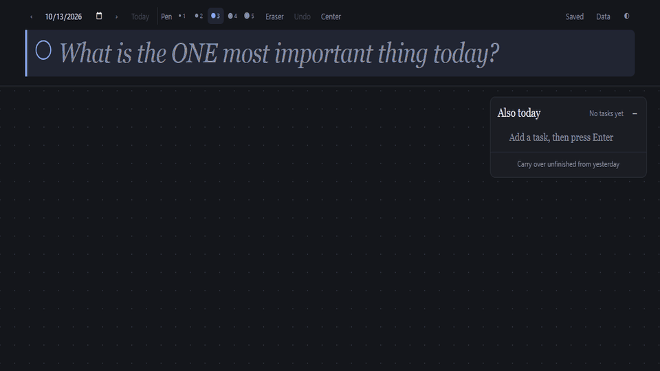

# Daily Planner

**A calm daily workspace for focused priorities, practical tasks, visual thinking, and quick sketches.** No accounts, installation, or internet connection required.



## Plan without breaking your flow

Daily Planner combines a structured day plan with an infinite, freeform canvas:

- **Lead with one priority.** Keep the day's Most Important Task prominent, then mark it complete when the work is done.
- **Handle the practical details.** Add, edit, complete, reorder, or carry unfinished tasks into the next day.
- **Map ideas visually.** Double-click to create formatted notes, arrange them spatially, then connect the thinking with hand-drawn lines, arrows, and lightweight diagrams.
- **Sketch naturally.** Right-drag to draw, choose from five pen weights, move notes or strokes, or erase with a full-gesture undo.
- **Move through an unlimited workspace.** Pan in any direction with drag, scroll, middle mouse, or Space-drag. Every day remembers its own view.
- **Stay distraction-free.** The paper-inspired interface keeps controls close without turning the workspace into a dashboard.

Everything saves automatically in the browser. The app includes multi-step canvas undo, light and dark themes, cross-tab updates, JSON backup and restore, and safeguards for interrupted edits or damaged storage.

## Start in seconds

1. Download or clone the repository.
2. Double-click `index.html`.
3. Start planning.

The application runs directly from `file://` and remains fully functional offline. There is no build command, local server, package installation, or runtime dependency.

## Essential controls

| Action | Interaction |
| --- | --- |
| Create or edit text | Double-click empty space or an existing block |
| Move text or a drawing | Left-drag the element |
| Draw | Right-drag on the canvas |
| Erase | Select **Eraser** or press `E`, then right-drag |
| Pan | Drag empty space, scroll, middle-drag, or Space-drag |
| Format text | Floating toolbar or `Alt+1` through `Alt+4` |
| Undo canvas action | `Ctrl+Z` / `Cmd+Z` or **Undo** |
| Add canvas text by keyboard | Press `N` at the last pointer position |

Native text undo remains available while typing.

## Local-first by design

- **Stack:** semantic HTML, responsive CSS, and vanilla JavaScript
- **Persistence:** one versioned JSON state in `localStorage`
- **Privacy:** no backend, accounts, analytics, cookies, or network requests
- **Portability:** export and import the complete planner as a JSON backup
- **Resilience:** sanitized data ingestion, corrupted-state recovery, quota warnings, and safe cross-tab adoption

Data belongs to the current browser and file origin. Moving the project, clearing browser data, or using private browsing can create a separate or temporary store, so export backups for long-term safekeeping.

## Project structure

```text
├── index.html                   # Accessible markup and pre-paint theme setup
├── app.js                      # State, persistence, rendering, and interactions
├── style.css                   # Original paper-and-ink interface
└── assets/
    └── daily-planner-demo.gif  # Product walkthrough captured from the app
```

The app intentionally ships without a package manifest, framework, CDN, web font, service worker, or build output.
